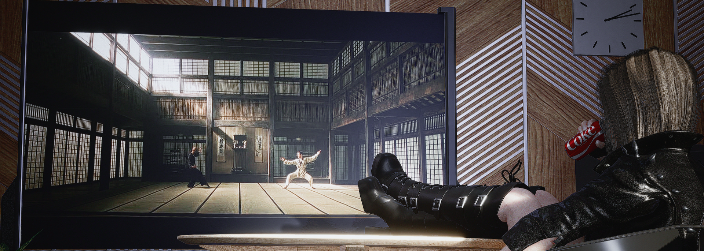
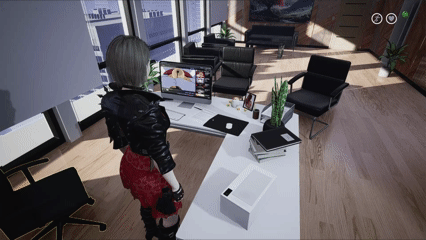
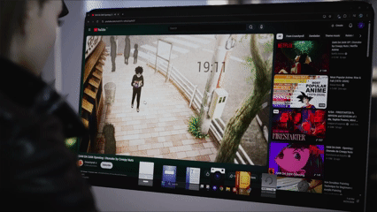
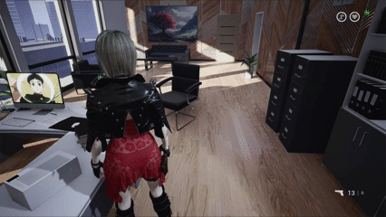
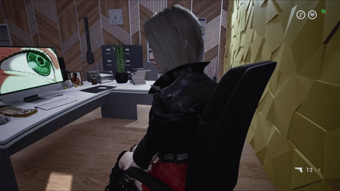
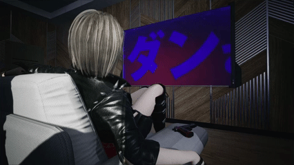

# DesktopTV

**Your PC's desktop, live on Jodi's TV and on her PC in *The Killing Antidote*, and you can use it from inside the game.**

YouTube on her TV. Your browser on her PC. Sound that follows her around the office. Works on Windows and on Linux (Steam / Proton).

---

## Features

- **Jodi's TV** shows one of your monitors live. Just play the `!Desktop` video on the TV.
- **Jodi's PC screen** shows the same monitor in place of her wallpaper. It works with the game's own wallpaper and with wallpaper mods like PCWallpaperQuiet.
- **PC mode (Insert)**: lean in at her PC, press Insert, and your mouse and keyboard work on your real desktop while you watch it in game.
  - A cursor is drawn on her screen and her own PC interface hides itself.
  - The game stays in front.
  - The cursor starts exactly where the game's cursor was, and goes back to the same spot.
  - Insert again takes you back to the game.
- **Spatial sound**: programs on that monitor (YouTube in a browser, a music player...) get louder as Jodi gets close to her PC or the TV, fade away with distance, and come from the left or right depending on where the camera looks.
- **Clean**: outside Jodi's office it does nothing at all (no capture, no checks, Insert left alone). Your programs get their sound back, with an even left/right, when you leave or close the game, and even after a crash.
- **Game files untouched**: it's a ReShade add-on (`DesktopTV.addon64`) plus a small UE4SS Lua script (`DesktopTVPos`). It only changes what the game draws on screen.

### PC mode at Jodi's desk

### Transition to your real desktop: type, click, comment

### Your desktop on Jodi's TV

### Use AltUI to remotely open the TV

---

## Requirements

1. **ReShade 6.8.0 with full add-on support** from [reshade.me](https://reshade.me) (the *second* download button). Install it on `TheKillingAntidote\Binaries\Win64\TheKillingAntidote-Win64-Shipping.exe` and pick DirectX 10/11/12.
   > ⚠️ The normal ReShade build will **not** work.
2. **UE4SS 3.0.1** ([RE-UE4SS](https://github.com/UE4SS-RE/RE-UE4SS)). Only needed for the sound that follows Jodi. Without it everything else works, and the sound simply plays while the desktop is on the TV or PC mode is on.
3. **A second screen** to show in game. With a single monitor, the TV just shows the game itself. A free virtual monitor works perfectly:
   - Download the control app: [VDD.Control.25.7.23.zip](https://github.com/VirtualDrivers/Virtual-Display-Driver/releases/download/25.7.23/VDD.Control.25.7.23.zip) (not a "Driver Only" file, not "Source code").
   - Extract it, run `VDD Control.exe`, click **Install Driver** and accept the Windows prompts.
   - In Windows Display settings, choose **Extend these displays**, keep your real monitor as the main display and set the virtual screen to 1920x1080.
   - Uninstall it from the same app before any big graphics-driver update.

---

## Installation

Copy the contents of the `TheKillingAntidote` folder from this repository into the game's `TheKillingAntidote` folder (the one that contains Binaries, Content, Videos...):

| File | What it is |
|---|---|
| `Binaries\Win64\DesktopTV.addon64` | the add-on (next to `dxgi.dll`) |
| `Binaries\Win64\DesktopTV_spots.txt` | where Jodi's PC and TV are in her office |
| `Binaries\Win64\Mods\DesktopTVPos\Scripts\main.lua` | the UE4SS script |
| `Binaries\Win64\Mods\DesktopTVPos\enabled.txt` | turns the script on |
| `Videos\TV\!Desktop.mp4` | the marker video for the TV |

---

## Settings

Start the game once and close it. The add-on adds a `[DesktopTV]` section to `Binaries\Win64\ReShade.ini`. With the game **closed**, replace that section with the one in `DesktopTV settings.ini` (the settings that worked best here). The game must be closed because ReShade reads the file at start and may rewrite it on exit.

| Setting | Meaning |
|---|---|
| `Monitor=2` | which screen to show (`ReShade.log` lists every monitor, numbered) |
| `FPS=30` | desktop updates per second (15 is lighter, 60 for 60 fps video) |
| `SRGB=2` | TV colours like the game's own TV videos (or force 0 / 1) |
| `TVOpaque=1` | makes the desktop opaque for the TV (without it: washed out, too bright) |
| `TVGamma=100` | TV contrast curve in percent (120 = darker mid-tones, 80 = lighter) |
| `Width` / `Height` | size of the marker video (1264 x 720, keep as is) |
| `PCScreen=1` | show the desktop on Jodi's PC screen |
| `PCSRGB=1` | colours on her PC screen (2 = automatic also works) |
| `PCWidth` / `PCHeight` | size of a wallpaper-mod picture such as PCWallpaperQuiet (1920 x 1080, keep as is). The game's own wallpaper is recognised automatically |
| `PCModeKey=45` | PC mode key (Windows key codes: 45 = Insert, 35 = End) |
| `HideUIKey=0` | extra key to hide Jodi's PC interface (145 = Scroll Lock, 0 = none) |
| `HideUI=0` | 1 = her interface hidden from the start |
| `HideUIInPCMode=1` | hide her interface while PC mode is on |
| `KeepFront=1` | keep the game in front during PC mode |
| `CursorScale=1.25` | size of the cursor drawn on her screen (1 = like Windows, decimals are fine) |
| `CursorOutline=0` | 1 = dark outline around that cursor (only 0 or 1) |
| `Sound=1` | control the sound of programs on the second screen |
| `Spatial=1` | sound follows Jodi (needs the DesktopTVPos script) |
| `NearCm=150` | full volume within 1.5 m of her PC or the TV |
| `FarCm=1200` | silent beyond 12 m |
| `SoundOutside=0` | outside her office: 0 = second-screen programs muted, 1 = left alone |
| `PCCorner=0` | keep at 0 (experimental, not working) |
| `PCScreenLeft/Top`, `PCScreenTRx/TRy`, `PCScreenRight/Bottom`, `PCScreenBLx/BLy` | where the 4 corners of her screen are in the game window when she leans in (see [Cursor calibration](#cursor-calibration)) |
| `LinuxSource=2` | 0 = Windows only, 1 = always use the Linux helper, 2 = use it only under Wine/Proton |
| `LinuxPort=47474` | port of the Linux helper |

---

## Using it

- **Before playing**, put what you want to watch (YouTube...) on the second screen: select its window and press **Win+Shift+Right** (or Left) to send it there. The other arrow brings it back.
  Lost a window? **Win+P → "PC screen only"** brings everything back, and **Win+P → "Extend"** restores the second screen.
- **TV**: in Jodi's office, switch the TV to the `!Desktop` video. If the TV shows the word **DESKTOP**, the add-on isn't running (check that ReShade is the add-on version).
- **Jodi's PC**: her screen shows the desktop all the time. Interact with her PC (she leans in) and press **Insert**: your cursor appears, her interface hides, and your mouse and keyboard work on your desktop. Press Insert again to come back. If the game ever leaves the screen anyway (Alt+Tab...), the cursor is released onto your main screen.
- The add-on catches Insert before other programs see it, in Jodi's office only.

> 🔒 **Privacy**: whatever is on the shown monitor appears in the game, including in your screenshots, recordings and streams.

---

## Cursor calibration

This sets things up so that PC mode starts where the game's cursor is.

`DesktopTV settings.ini` already holds a calibration made for a 1920x1080 game window. If PC mode puts your cursor in the wrong place, redo it:

1. Lean in at Jodi's PC.
2. Put the game's cursor exactly on each corner of the visible screen picture and press:

| Keys | Corner |
|---|---|
| Ctrl+Shift+F8 | top-left |
| Ctrl+Shift+F10 | top-right |
| Ctrl+Shift+F9 | bottom-right |
| Ctrl+Shift+F11 | bottom-left |

`ReShade.log` confirms each corner. It says "4 corners set (tilt corrected)" when you're done.

---

## Sound positions

`DesktopTV_spots.txt` already holds the PC and TV spots for Jodi's office. To set them yourself, stand at Jodi's desk and press **Ctrl+F8** (PC), then stand in front of the TV and press **Ctrl+F9** (TV). The script only works on maps that have spots.

The add-on takes over the volume of second-screen programs while you're in her office. It gives the volume back when you leave or when the game closes. After a crash, the next start gives it back.

---

## Logs (if something doesn't work)

| File | Look for |
|---|---|
| `Binaries\Win64\ReShade.log` | lines starting with `DesktopTV:` (the first one says which version loaded) |
| `Binaries\Win64\UE4SS.log` | lines starting with `[DesktopTVPos]` ("loaded", then "following Jodi via ..." once in her office) |

Please include both with bug reports.

---

## Antivirus warnings

To do its job, the add-on:
- captures one screen;
- reads the keyboard while you're in Jodi's office (so Insert doesn't reach other programs);
- changes the volume of programs on the second screen;
- keeps the game window in front during PC mode.

Some antivirus programs flag DLLs that do this kind of thing. The full source code is in this repository, so anyone can check it and build the add-on themselves.

---

## Linux (Steam / Proton)

The same add-on works under Proton, with a small Linux helper that handles the picture, PC mode and sound (tested on KDE Plasma 6, Wayland). Everything is in the [`Linux`](Linux) folder. Start with [`Linux/HOW_TO_DesktopTV_Linux.txt`](Linux/HOW_TO_DesktopTV_Linux.txt).

On Windows the Linux part stays switched off by itself (`LinuxSource=2`).

---

## Building the add-on yourself

This is optional: a ready-built `DesktopTV.addon64` is included.

`Source` holds:
- the add-on source: `src\desktoptv_addon.cpp`, plus `src\desktoptv_linux.inl` for the Linux part;
- the ReShade 6.8.0 add-on SDK headers in `reshade_include`, from [crosire/reshade](https://github.com/crosire/reshade) (license included);
- `build.bat`.

- **Windows**: you need Visual Studio 2022 or newer with the C++ tools ("Desktop development with C++"; the free Build Tools are enough). Double-click `build.bat` and the add-on appears at `build\DesktopTV.addon64`.
- **Linux**: run `Linux/build_linux.sh` (MinGW). See the Linux how-to.

---

## Version history

- **1.2** (add-on v5.0, 2026-10-28)
  - **Your browser no longer gets stuck in one ear.** DesktopTV always starts from, and gives back, an even left/right, and repairs any program it ever panned when the game starts and closes.
  - **The game keeps its sound in PC mode.** Alt+Tab still mutes the game as before.
- **1.1** (add-on v4.9, 2026-10-25): works with the game's own wallpaper on Jodi's PC (PCWallpaperQuiet no longer needed).
- **1.0** (add-on v4.8, 2026-10-24): first release.

---

## Credits

- **Zyiakk**: the Linux / Proton port, and **AltUI**, whose TV tool turns the TV on and picks the `!Desktop` video in one click.
- **crosire**: [ReShade](https://reshade.me) and its add-on SDK.
- **The UE4SS team**: [RE-UE4SS](https://github.com/UE4SS-RE/RE-UE4SS).
- **The Virtual Display Driver authors**: [VDD](https://github.com/VirtualDrivers/Virtual-Display-Driver).

